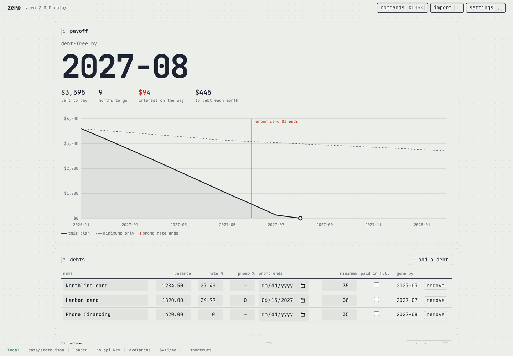
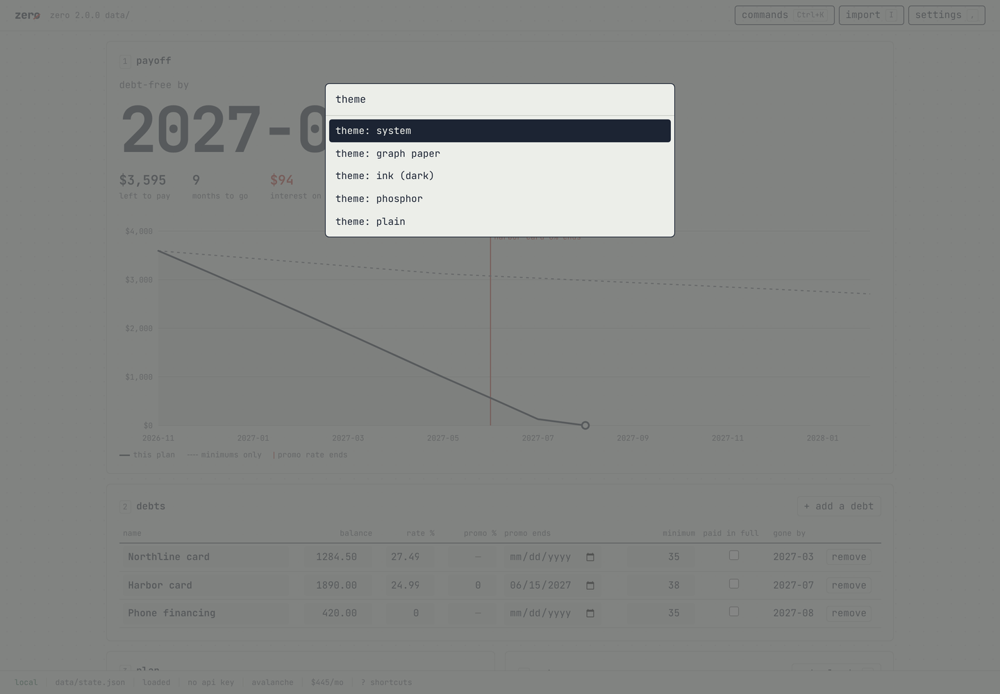
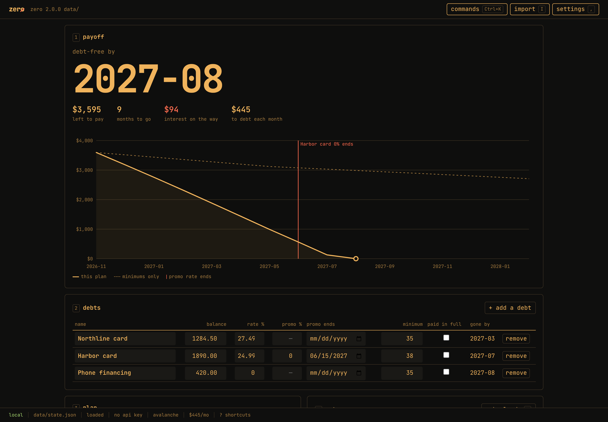

# zero

[](https://github.com/aposoloam/zero/actions/workflows/test.yml)

**[try the demo](https://aposoloam.github.io/zero/)**: it runs in your browser with sample numbers, and nothing is sent anywhere.



a local, private debt payoff planner. import your bank and card statements, try
payoff strategies, and see the month you hit $0.

it runs on your own computer. your numbers and your api key stay in a folder you
can open, read and back up. nothing goes anywhere else unless you ask Claude for
help.

- **the line to zero**: a month-by-month payoff plan. pay the highest rate first,
  the smallest balance first, or your own order. it understands 0% promo deadlines
  and cards you pay in full, and has student mode, extra-shift and one-time
  payment controls.
- **imports**: csv exports from Capital One, Chase and Apple Card are recognized
  automatically, and any other csv gets a column picker. Claude reads PDF
  statements and screenshots. importing the same file twice adds nothing.
- **notes**: plain-language insights worked out on your machine, plus *ask claude*
  for a deeper read using your own Anthropic API key.
- **yours to change**: four themes, any color, any installed font, one or two
  columns, panes you can reorder or hide, rebindable shortcuts, a command
  palette, and a `settings.json` you can edit by hand.

no framework, no build step, no dependencies: Node's standard library on the
server, plain html, css and javascript modules in the browser.

## run it

needs [Node](https://nodejs.org) 22 or newer.

```sh
git clone https://github.com/aposoloam/zero.git
cd zero
npm start
```

open **http://localhost:4321**. you'll see sample numbers first. import a statement,
or choose *start empty* from the command palette.

to use Claude, open settings (<kbd>,</kbd>) → claude → paste your API key from
[console.anthropic.com](https://console.anthropic.com). zero checks the key with
Anthropic, then saves it to `data/secrets.json`.

| variable | default | |
|---|---|---|
| `ZERO_PORT` | `4321` | port to listen on (always 127.0.0.1) |
| `ZERO_DATA_DIR` | `./data` | where state, settings and the key are kept |
| `ANTHROPIC_API_KEY` | none | use this key instead of one saved from the app |
| `ZERO_MODEL` | from settings | force a model for every Claude call |

## keyboard

| key | does |
|---|---|
| <kbd>⌘K</kbd> / <kbd>Ctrl K</kbd> | command palette: every action, theme and pane |
| <kbd>1</kbd>–<kbd>9</kbd> | jump to a pane |
| <kbd>I</kbd> | import |
| <kbd>A</kbd> | ask claude |
| <kbd>S</kbd> | student mode on/off |
| <kbd>/</kbd> | search transactions |
| <kbd>,</kbd> | settings |
| <kbd>?</kbd> | all shortcuts |

every binding can be changed in settings or in `settings.json`.



## your data

everything lives in `data/` (git ignores it):

```
data/
  state.json      debts, transactions, plan, category corrections
  settings.json   only the settings you changed from the defaults
  secrets.json    your api key (owner-only permissions)
```

they're plain JSON, so you can back them up, sync them, put them under version
control in a private repo, or edit them by hand while zero is stopped. *download
backup* gives you a copy of `state.json`, and importing a backup brings it back.

## customizing



open settings (<kbd>,</kbd>) and scroll to **settings.json**, or edit
`data/settings.json` directly. anything you leave out uses the default, and any
invalid value is ignored with a warning in the app.

```json
{
  "theme": "phosphor",
  "colors": { "accent": "#7aa2f7", "danger": "#ff5f5f" },
  "font": "Berkeley Mono",
  "fontSize": 15,
  "density": "compact",
  "columns": 2,
  "panes": ["payoff", "debts", "plan", "notes", "flow", "transactions"],
  "wide": ["payoff", "debts", "flow", "transactions"],
  "dates": "iso",
  "locale": "en-GB",
  "currency": "GBP",
  "chart": { "animate": true, "minimums": true, "promos": true },
  "model": "claude-sonnet-5-5",
  "keys": { "palette": "mod+k", "import": "i", "ask": "a", "student": "s", "search": "/", "settings": ",", "help": "?" }
}
```

- **themes**: `system` (graph paper by day, ink by night), `graph`, `ink`,
  `phosphor`, `plain`. `colors` overrides any of `bg surface fg muted rule accent
  danger good` on top of the theme.
- **fonts**: `mono` (JetBrains Mono), `sans` (Hanken Grotesk), or the name of any
  font installed on your computer. both bundled fonts are under the SIL Open
  Font License.
- **panes**: `payoff debts plan notes flow transactions`. the order of `panes`
  is the order on screen. leave one out to hide it. `wide` panes span both
  columns.

## security

zero holds financial data and an API key, so the local server is strict:

- it only listens on `127.0.0.1`, so nothing else on your network can reach it.
- every `/api` request must carry this app's own `Host`, a matching `Origin`,
  and an `x-zero` header. that stops websites you visit (including DNS-rebinding
  tricks) from reading your data or spending your key.
- the API key is written with `0600` permissions, checked with Anthropic before
  it's saved, and never sent back to the browser. the app only ever sees its
  last four characters.
- Claude's prompts live on the server. the browser can only ask for the two
  fixed jobs (insights, statement reading), so the server can't be used as a
  general Claude relay.
- *ask claude* sends a summary: totals, your debts, the plan, and your top
  merchants from the last 30 days. it never sends account numbers or full
  transaction lists. statement imports send the file you chose.
- strict content security policy: only zero's own scripts, styles and fonts. no
  third-party code, no CDNs, no analytics. every imported string is escaped
  before it reaches the page.
- files are written atomically (write, then rename), so a crash can't leave
  half a file.

found a vulnerability? please report it privately. see [SECURITY.md](SECURITY.md).

## demo mode

`public/` also works as a plain static site (GitHub Pages, Cloudflare Pages, a
portfolio). without the server, zero runs in **demo mode**: data stays in that
browser's localStorage and Claude is off, because API keys are never stored in
a browser. good for showing it off; run it locally for real use.

## how the math works

each month, interest is added to each balance (rate ÷ 12), every minimum is
paid, and the rest of the monthly budget goes to debts in strategy order. a
promo rate counts until the month it ends. a card marked *paid in full* never
accrues interest and is always paid first. money freed by a paid-off debt rolls
into the next one. `tests/payoff.test.mjs` pins the results to a hand-checked
spreadsheet.

## project layout

```
server.js             local server: static files, data files, api key, claude
lib/claude.js         the two claude jobs (prompts + structured output)
public/
  index.html          every pane and dialog, top to bottom
  css/zero.css        layout and components; colors come from settings
  js/main.js          wires the page together (start here)
  js/settings.js      themes, defaults, validation for settings.json
  js/api.js           server calls, or browser storage in demo mode
  js/payoff.js        the payoff simulation (pure, tested)
  js/importers.js     csv parsing, bank presets, column guessing
  js/categorize.js    category rules and merchant matching
  js/analysis.js      money in/out, categories, merchants
  js/insights.js      local notes, and the summary sent to claude
  js/charts.js        two hand-drawn svg charts
  js/palette.js       command palette
  js/keys.js          keyboard shortcuts
  js/state.js         data shape, backups, budget math
  js/format.js        money/date formatting, html escaping
  js/demo.js          made-up sample data
tests/                node:test, no dependencies — run `npm test`
```

## contributing

- **another bank's csv**: add an entry to `PRESETS` in `public/js/importers.js`
  (the header columns it must have, and how to read one row), and a test in
  `tests/importers.test.mjs`.
- **a merchant categorized wrong**: add a pattern to `RULES` in
  `public/js/categorize.js`.
- **a theme**: add it to `THEMES` in `public/js/settings.js`.

keep it dependency-free and readable without a build step. `npm test` must pass.

## license

MIT
